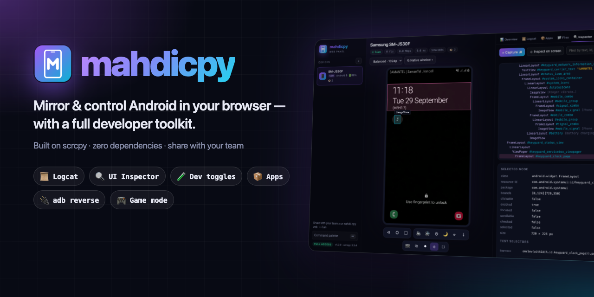
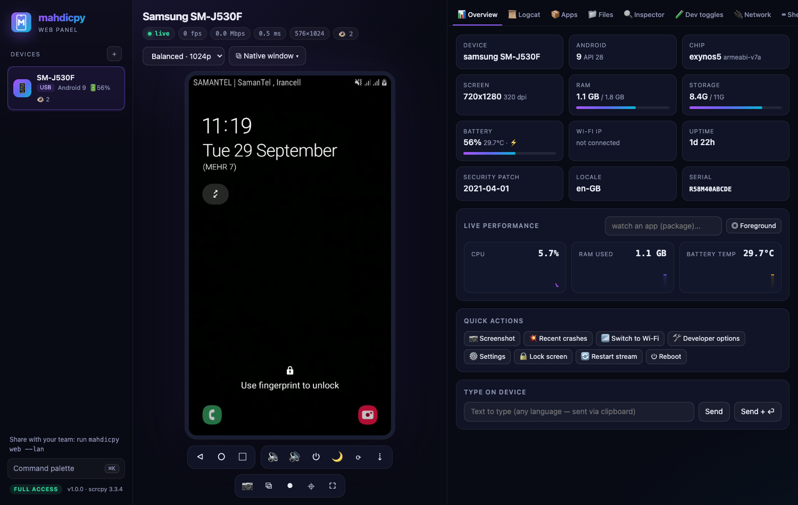
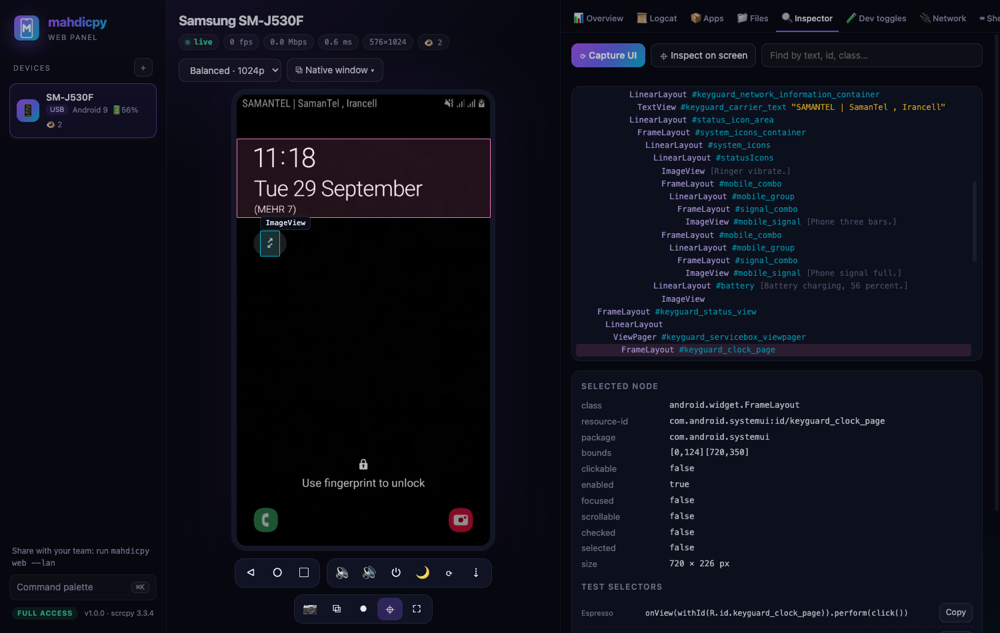
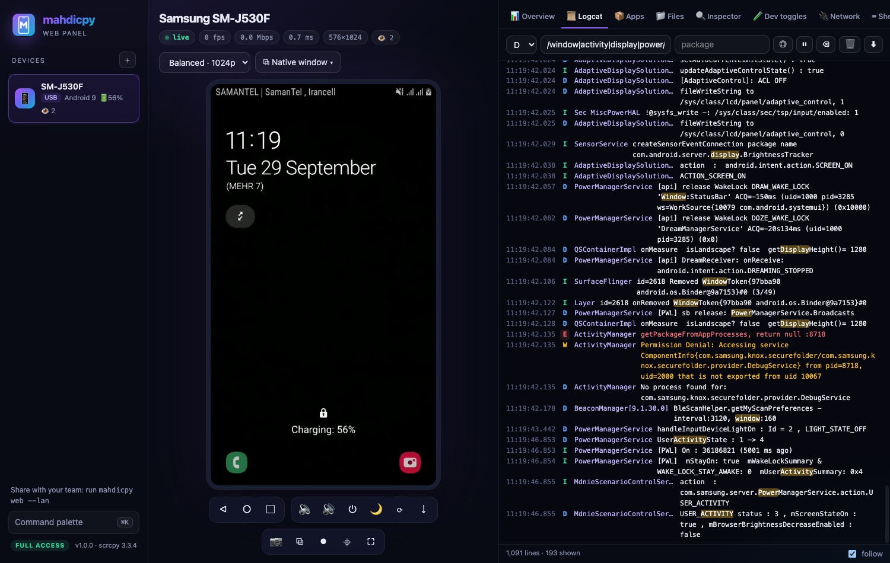
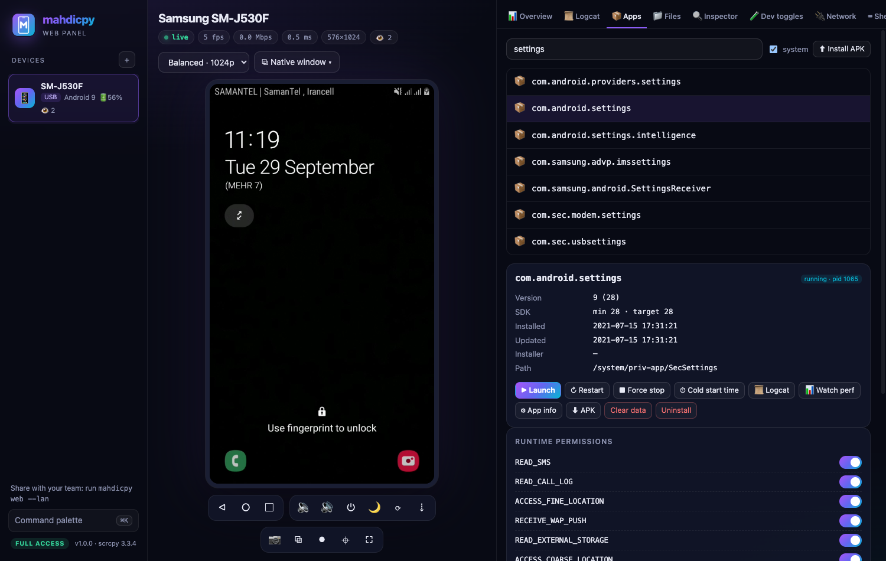
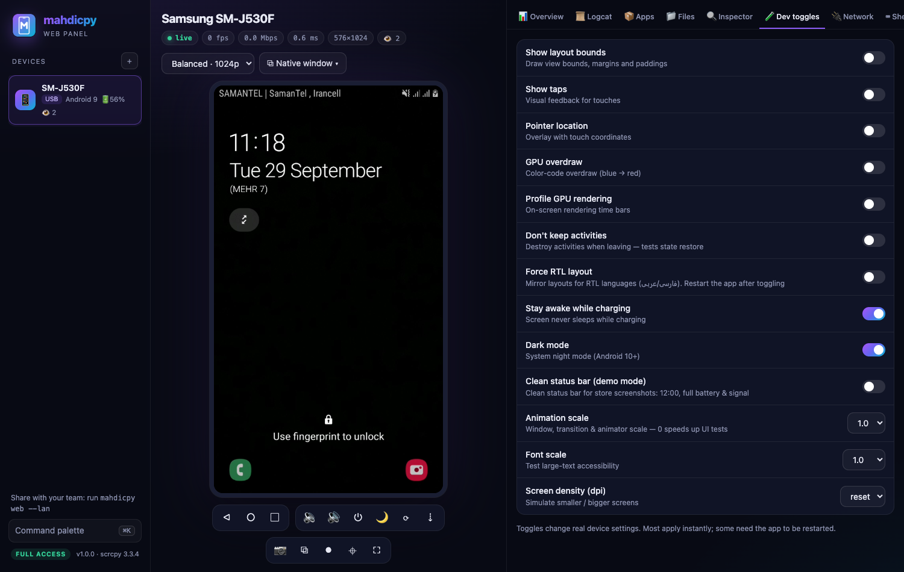
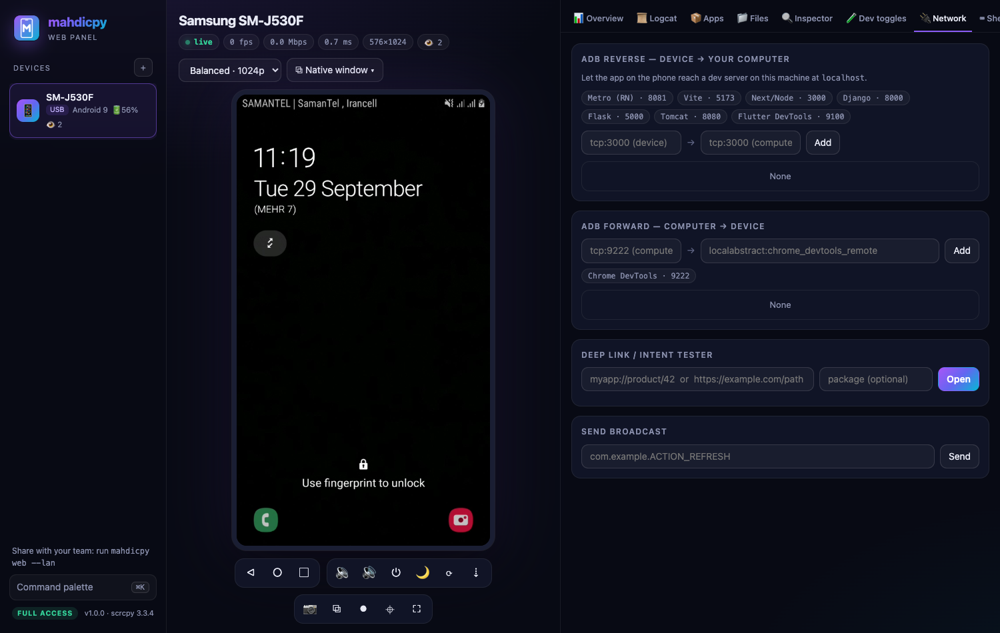
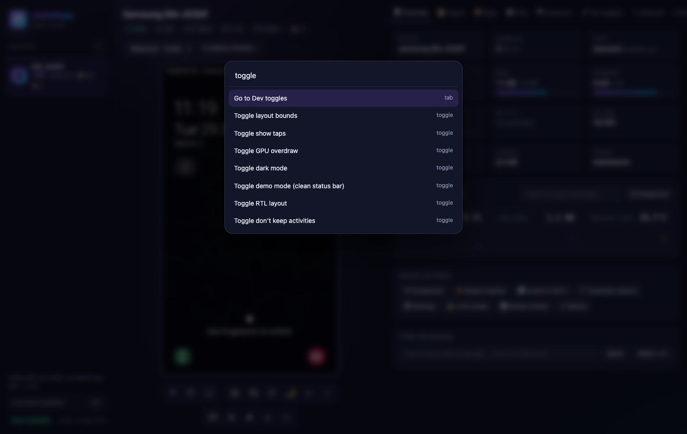

<div align="center">



# mahdicpy

### Mirror & control your Android phone in the browser — with a built-in developer toolkit.

**scrcpy's speed · a web UI anyone can open · Logcat, UI Inspector, app manager & dev toggles in one tab.**

[](https://github.com/mahditavakoli1312/mahdicpy/stargazers)
[](LICENSE)
[](#-install)
[](#-how-it-works)
[](https://github.com/mahditavakoli1312/mahdicpy/actions)

**English** · [فارسی](README.fa.md)

[Install](#-install) · [Web panel](#-the-web-panel) · [Developer toolkit](#-developer-toolkit) · [CLI](#-the-cli) · [FAQ](#-faq)

</div>

---

## ✨ Why mahdicpy?

[scrcpy](https://github.com/Genymobile/scrcpy) is the best way to mirror Android — but it's a bare window and a wall of flags.
**mahdicpy** keeps scrcpy's engine and adds everything around it that Android developers reach for every day:

- 🌐 **Open your phone in any browser.** Real H.264 video decoded with WebCodecs, sub-millisecond LAN latency, full touch/keyboard/clipboard control.
- 👥 **Share it with your team.** One command gives you a *full-access* link and a *view-only* link for demos, QA and pair debugging.
- 🛠 **A developer toolkit next to the screen.** Live Logcat, UI Inspector that generates test selectors, app manager with cold-start timing, dev toggles, `adb reverse`, deep-link tester, file browser and a shell.
- ⚡ **A smarter CLI.** `mahdicpy game`, `mahdicpy wifi`, `mahdicpy app telegram`, `mahdicpy rec --gif` — presets instead of memorising flags.
- 📦 **Zero dependencies.** Python standard library + the official scrcpy release. No npm, no pip, no Electron.

<div align="center">

</div>

---

## 🚀 Install

```bash
git clone https://github.com/mahditavakoli1312/mahdicpy.git
cd mahdicpy
./install.sh        # downloads the official scrcpy 3.3.4 release (with adb), verifies SHA-256, links `mahdicpy`
```

Already have scrcpy (`brew install scrcpy`, `apt install scrcpy`)? Skip `install.sh` — mahdicpy finds it on your `PATH`.

**Phone setup (once):** *Settings › About phone* → tap **Build number** 7× → *Developer options* → enable **USB debugging** → plug in and accept the prompt.

```bash
mahdicpy doctor     # checks scrcpy, adb, the server and your devices
mahdicpy web        # 🌐 opens the web panel
mahdicpy            # 📱 classic native scrcpy window, auto-tuned
```

---

## 🌐 The web panel

```bash
mahdicpy web          # private — only this computer (http://127.0.0.1:8765)
mahdicpy web --lan    # share on your network over HTTPS, with full & view-only links
```

| | |
|---|---|
| 🖱 **Full control** | Click, drag, scroll, multi-touch on touchscreens. Right-click = Back, middle-click = Home. |
| ⌨️ **Keyboard & clipboard** | Click the screen to capture the keyboard. `⌘C` / `⌘V` sync the clipboard both ways; any language works (Persian, Arabic, emoji…). |
| 🎥 **Capture** | Full-res screenshots, copy frame to clipboard, record the stream to WebM. |
| 🌙 **Screen-off mirroring** | Turn the phone's display off while you keep working on it. |
| 👁 **Multi-viewer** | Many people can watch one device; a single stream is shared, with a live viewer count. |
| 🔐 **Access control** | Token-protected; `--lan` prints a **full-access** link and a **view-only** link (no control, no tools). |
| ⌘K **Command palette** | Fuzzy-search every action: *"toggle layout bounds"*, *"launch org.telegram…"*, *"rotate"*. |
| 📥 **Drag & drop** | Drop an `.apk` anywhere to install it; any other file goes to `/sdcard/Download`. |
| ⧉ **Native window** | Pop a native scrcpy window from the browser with any preset. |

---

## 🛠 Developer toolkit

<table>
<tr>
<td width="50%"></td>
<td width="50%"></td>
</tr>
<tr>
<td><b>🔍 UI Inspector</b> — dump the view hierarchy, hover the <i>live</i> screen to highlight elements, click to get ready-to-paste selectors for <b>Espresso, UiAutomator, Compose, Appium, Maestro</b> and <code>adb</code>.</td>
<td><b>📜 Logcat</b> — live, colour-coded, filter by level, text, <code>tag:Name</code> or <code>/regex/</code>, per-package (PID) filtering, <b>automatic crash & ANR alerts</b>, export.</td>
</tr>
<tr>
<td></td>
<td></td>
</tr>
<tr>
<td><b>📦 Apps</b> — version, SDKs, installer, debuggable flag; launch / restart / force-stop / clear / uninstall; <b>measure cold-start time</b> (with averages); toggle runtime permissions; pull the APK.</td>
<td><b>🧪 Dev toggles</b> — layout bounds, GPU overdraw, profile GPU, <b>don't keep activities</b>, <b>force RTL</b>, <b>demo mode</b> (clean status bar for store screenshots), animation scale, font scale, density.</td>
</tr>
<tr>
<td></td>
<td></td>
</tr>
<tr>
<td><b>🔌 Network</b> — one-click <code>adb reverse</code> for Metro, Vite, Next.js, Django, Flask, Flutter DevTools; <code>adb forward</code> (Chrome DevTools); <b>deep-link tester</b> with launch time & history; broadcasts.</td>
<td><b>⌘K Palette</b> — every action is one keystroke away.</td>
</tr>
</table>

Also included: **📊 Overview** (device specs + live CPU / RAM / temperature charts, per-app memory & jank %), **📁 Files** (browse, upload, download, rename, preview images/video/text) and **⌨ Shell** (history, snippets, exit codes & timings).

---

## 💻 The CLI

Every scrcpy option still works — mahdicpy forwards anything it doesn't know.

| Command | What it does |
|---|---|
| `mahdicpy` | Smart mirroring, auto-tuned for USB vs Wi-Fi, device name in the title |
| `mahdicpy game` | 120 fps, zero buffering, physical keyboard (UHID) |
| `mahdicpy hq` / `low` | Maximum quality / weak-network mode |
| `mahdicpy present` | Show touches, always on top, stay awake — for demos |
| `mahdicpy stealth` | Phone screen stays off while you use it |
| `mahdicpy desktop [WxH/dpi]` | Separate desktop-like virtual display |
| `mahdicpy app <name>` | Open an app by name in its own window |
| `mahdicpy cam [front\|back]` · `audio` · `mic` · `otg` | Camera, audio-only, phone-as-mic, OTG |
| `mahdicpy all` | Mirror **every** connected device, tiled on screen |
| `mahdicpy wifi [ip]` | Go wireless in one step — remembers the last phone |
| `mahdicpy pair` | Wireless pairing for Android 11+ |
| `mahdicpy rec [--gif]` | Auto-named recording to `~/Movies/mahdicpy`, optional GIF |
| `mahdicpy shot` | Screenshot to `~/Pictures/mahdicpy` **and** your clipboard |
| `mahdicpy info` | Device dashboard: battery, storage, RAM, IP… |
| `mahdicpy install *.apk` | Install one or more APKs |
| `mahdicpy profile save work -m 1280 --always-on-top` → `mahdicpy @work` | Saved option sets |

Global flags: `--watch` (auto-reconnect), `--rec`, `-s <serial|ip>`, `@profile`, `--dry-run`. Run `mahdicpy help` for everything.

---

## ⚙️ How it works

```
 Browser ── WebSocket (H.264 + control) ──▶ web/server.py ── adb forward ──▶ scrcpy-server (on the phone)
    │                                            │
    └──── JSON API (Logcat, apps, files…) ──────┴── adb shell / pm / am / uiautomator / dumpsys
```

- `web/server.py` pushes the official **scrcpy-server** to the device and speaks its protocol directly — no scrcpy window needed.
- One session per device is **shared by all viewers**; late joiners get a fresh keyframe instantly.
- The browser decodes H.264 with **WebCodecs** (hardware-accelerated) and draws to a canvas. Browsers without WebCodecs fall back to snapshot mode.
- Standard library only: `http.server`, a tiny WebSocket implementation, `subprocess` + `adb`.

---

## 🔐 Security

- The panel listens on `127.0.0.1` unless you pass `--lan`.
- Every API call and stream needs a token; other websites in your browser can't reach it.
- `--lan` enables HTTPS with a self-signed certificate (browsers require HTTPS for WebCodecs). Accept the warning once.
- **The full-access link grants `adb shell` on your phone** — share it only with people you trust. Use the view-only link for demos. Rotate with `mahdicpy web --new-tokens`.

---

## ❓ FAQ

<details><summary><b>Which devices / OSes are supported?</b></summary>

Any Android 5.0+ device with USB debugging (audio needs 11+, camera 12+, virtual displays 10+).
Host: macOS (Intel & Apple Silicon) and Linux x86_64 via `install.sh`; anywhere scrcpy runs if it's on your `PATH`.
Viewers: any modern browser — Chrome/Edge, Safari 16.4+, Firefox 130+.
</details>

<details><summary><b>Do I need root?</b></summary>

No. Everything runs through adb as the `shell` user.
</details>

<details><summary><b>Is this a fork of scrcpy?</b></summary>

No — it's a companion. mahdicpy uses the **unmodified official scrcpy release** (downloaded by `install.sh`) and builds a CLI and web panel on top. All credit for the mirroring engine goes to [Genymobile/scrcpy](https://github.com/Genymobile/scrcpy).
</details>

<details><summary><b>The video is choppy / only snapshots on another computer</b></summary>

Use `mahdicpy web --lan` (HTTPS) rather than `--http`: browsers only expose WebCodecs on secure origins. On weak Wi-Fi, choose **Low · 720p** in the quality menu.
</details>

<details><summary><b>Which scrcpy version?</b></summary>

`install.sh` pins **scrcpy 3.3.4** (the version the web protocol is tested against). Override with `SCRCPY_VERSION=x.y.z ./install.sh` at your own risk.
</details>

---

## 🗺 Roadmap

- [ ] Audio streaming in the web panel
- [ ] Multi-device grid view in the browser
- [ ] Network inspector (HTTP traffic via proxy)
- [ ] Macro recorder & replay for repetitive QA flows
- [ ] Windows installer
- [ ] Persian UI translation

Have an idea? [Open an issue](https://github.com/mahditavakoli1312/mahdicpy/issues/new/choose) — feature requests are very welcome.

## 🤝 Contributing

PRs welcome! See [CONTRIBUTING.md](CONTRIBUTING.md). The codebase is small and dependency-free:
`mahdicpy` (CLI), `web/server.py` (backend), `web/app.js` (frontend).

## ⭐ Support the project

If mahdicpy saves you time, **please star the repo** — it's the best way to help others find it.

[](https://star-history.com/#mahditavakoli1312/mahdicpy&Date)

## 📄 License

[Apache-2.0](LICENSE). mahdicpy downloads and uses [scrcpy](https://github.com/Genymobile/scrcpy) (Apache-2.0, © Genymobile / Romain Vimont) and `adb` from the Android SDK platform-tools, which are not redistributed in this repository.

<div align="center"><sub>Made with 💜 by <a href="https://github.com/mahditavakoli1312">Mahdi Tavakoli</a></sub></div>
